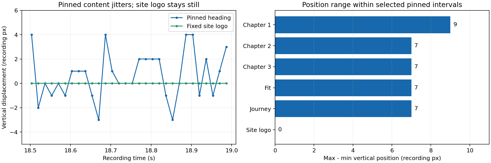
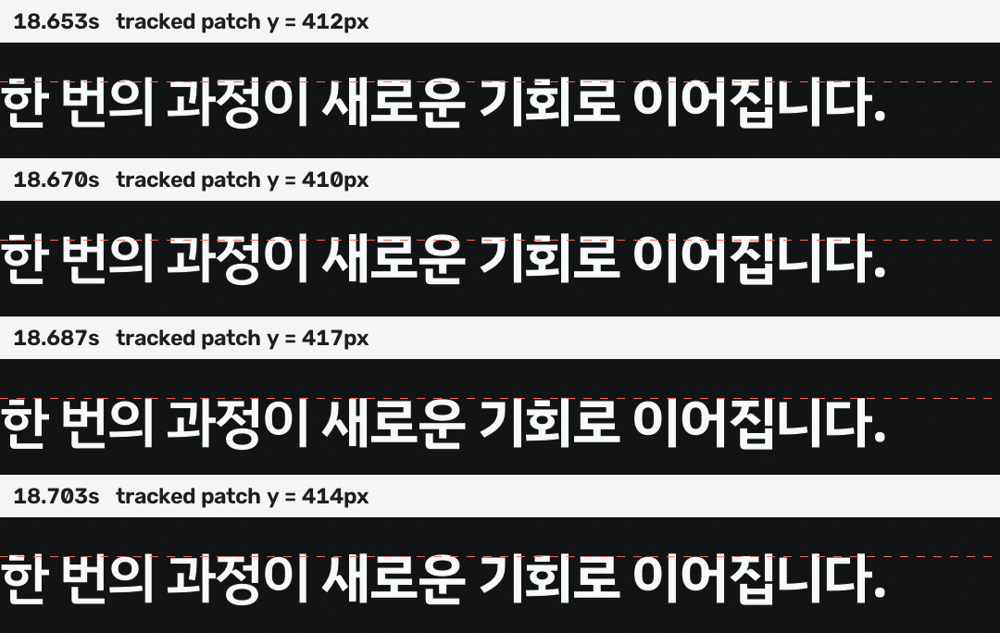

# iPhone 화면 녹화 분석

영상에서 **sticky로 고정되는 본문 제목이 반복적으로 위아래로 흔들리는 현상**을 확인했다. 선택한 고정 구간에서 흔들림 범위는 녹화 원본 기준 7~9px이다. 같은 화면의 `position: fixed` 상단 로고는 정수 픽셀 위치가 변하지 않았다. 따라서 앞선 누적 CPU 비용 분석과 별도로, 고정 영역의 위치 안정성을 우선 조사해야 한다.

## 자료와 방법

- 사용자 제공 환경: iPhone 17 Pro, Safari, iOS 27 개발자 베타. OS 버전은 사용자 설명이며 영상만으로 별도 확인하지 않았다.
- 파일: `ScreenRecording_10-14-2026 16-34-46_1.MP4`.
- 원본: 1206×2622, AVFoundation 측정 길이 26.022초, nominal 59.988fps. 메타데이터상 1,562프레임, OpenCV로 1,561프레임 디코딩했다. 이 차이를 웹페이지의 프레임 드롭으로 해석하지 않는다.
- 장면별로 애니메이션이 없는 제목의 이미지 조각을 원본 해상도에서 normalized cross-correlation으로 추적했다. 검색 영역은 참조 위치 주변 세로 ±30px·가로 ±6px이며 상관계수 0.9 이상만 채택했다. 가로 위치는 채택한 제목 샘플에서 변하지 않았다.
- 장면 진입·해제 중의 정상 스크롤 이동을 제외한 시간 구간을 선정했다. Safari 하단 UI가 펼쳐지기 시작하는 약 22.487초 이후는 서비스 단계 통계에서 제외했다.
- 모든 px는 **녹화 원본의 영상 픽셀**이다. CSS px로 변환하지 않았다. 영상은 DOM 좌표·스크롤 이벤트·메인 스레드 타이밍을 제공하지 않으므로 위치 흔들림을 CPU 지연 시간이나 실제 화면 dropped frame 비율로 환산하지 않는다.
- 원본 해시, 프레임별 좌표·상관계수·추적 사례는 [tracking.json](tracking.json)에 있다.

## 정량 결과

| 고정 요소 | 분석 구간(초) | 유효/추적 프레임 | 세로 위치 범위 | 최대 연속 프레임 이동 | 2px 이상 이동 후 역방향 이동 지점 |
| --- | --- | ---: | ---: | ---: | ---: |
| 자기소개서 구간 제목 | 3.600~6.100 | 150/150 | 9px | 8px | 56 |
| 채용 일정 구간 제목 | 7.800~10.400 | 156/156 | 7px | 7px | 46 |
| 제안 대기 구간 제목 | 11.700~13.300 | 96/96 | 7px | 7px | 23 |
| 매칭률 구간 제목 | 14.900~17.000 | 122/126 | 7px | 7px | 40 |
| 서비스 단계 구간 제목 | 18.100~22.450 | 261/261 | 7px | 7px | 74 |
| 상단 로고 대조군 | 3.600~22.450 | 1048/1131 | 0px | 0px | 0 |

위치 범위는 max(y)−min(y)다. 마지막 열은 연속 3프레임에서 앞뒤 이동이 각각 2px 이상이고 방향이 반대인 중앙 프레임 수다. 서로 겹치는 3프레임 창이 포함되므로 독립된 진동 횟수가 아니다. 로고가 다른 요소에 가려지거나 제목 매칭이 불확실한 프레임은 제외했다. 소수점 peak 보간으로는 로고 좌표 범위가 약 0.46px였지만 정수 픽셀 좌표는 동일했다.

### 연속 프레임 사례

서비스 단계 제목을 추적한 영상 좌표는 다음과 같다. 좌표는 제목 이미지 조각의 기준점이며 글자 자체의 위쪽 경계와는 다르다.

| 영상 시간 | 추적 y | 직전 프레임과 차이 |
| --- | ---: | ---: |
| 18.653초 | 412px | — |
| 18.670초 | 410px | −2px |
| 18.687초 | 417px | +7px |
| 18.703초 | 414px | −3px |

약 16.7ms 간격의 녹화 프레임에서 아래로 7px 이동한 뒤 다음 프레임에서 위로 3px 돌아왔다. 여기서 16.7ms는 녹화 프레임 간격이며 JS 지연 시간은 아니다. 같은 구간의 카드도 1252→1250→1258→1254px로 거의 함께 이동했다. 18.1~20.6초 카드 추적 150프레임의 위치 범위는 8px였고, 제목과 카드 사이 상대 위치 범위는 2px였다.

## 관찰이 지지하는 원인과 미확정 부분

**본문의 고정 영역 전체 위치 처리**가 가장 우선적인 조사 대상이다. 서로 다른 sticky 장면에서 애니메이션이 없는 제목이 흔들리고, 제목과 카드가 거의 함께 움직이며, 상단 fixed 로고는 안정적이기 때문이다. 이 설명은 영상과 코드 대조에 따른 추론이며 Safari 내부의 특정 버그가 확인됐다는 뜻은 아니다.

코드는 `.sticky`, `.fit-sticky`, `.j-sticky`에 `position: sticky; top: 0; height: 100svh`를 적용한다. 장면별로 스크롤을 강제로 되돌리는 코드는 없다. 자기소개서 제목은 최종 CSS에서 `transform: none`이고, 서비스 단계의 고정 제목도 스크롤에 따라 세로 transform을 변경하지 않는다. 그러므로 관찰된 제목 이동을 의도된 제목 애니메이션으로 설명하기 어렵다.

선정한 고정 구간에서 하단 브라우저 UI의 흰 배경 경계는 402px 폭으로 축소한 영상 기준 y=816에 머문다. 약 22.487초부터 UI 경계가 움직였지만, 그 이전부터 제목 흔들림이 존재한다. **주소창 펼침/접힘만으로 모든 떨림을 설명할 수는 없다.** 다만 영상 경계가 고정됐다고 DOM의 `innerHeight`·`visualViewport` 값이 일정했다고 확정할 수는 없다.

반복 레이아웃이나 메인 스레드 갱신이 sticky 위치 처리와 겹쳐 영향을 주는지, 브라우저 합성 경로에서 발생하는지, 개발자 베타에 한정되는지는 아직 구분하지 못했다. iOS 27 베타라는 정보만으로 OS 버그라고 단정하지 않는다. 앞선 Canvas CPU 비용 역시 아래 모든 구간의 공통 떨림을 직접 설명한 근거가 아니다.

## 다음 검증

1. 같은 iPhone에서 제목·카드의 `getBoundingClientRect().top`, `scrollY`, `innerHeight`, `visualViewport.offsetTop/height`를 동시에 기록한다. DOM 좌표가 영상과 함께 움직이면 레이아웃/좌표 계산을, DOM 좌표가 안정적인데 영상만 움직이면 합성/표시 경로를 우선 조사한다. 계측 자체의 비용도 대조군으로 확인한다.
2. sticky를 유지하면서 해당 장면의 JS 갱신만 정지하는 대조군을 만든다. 디자인과 스크롤 거리를 유지해 레이아웃 갱신의 영향을 분리한다.
3. 동일한 내용과 긴 스크롤 구간을 가진 최소 sticky 페이지에서 재현되는지 비교한다. 그 후 실제 페이지의 조상 요소·overflow·필터·레이어 구성을 하나씩 추가한다.
4. 가능하면 정식 iOS Safari에서도 동일 조건을 비교한다. 개발자 베타 특이 현상 여부는 이 비교 후 판단한다.

이 분석에서는 애플리케이션 동작을 수정하지 않았다.
